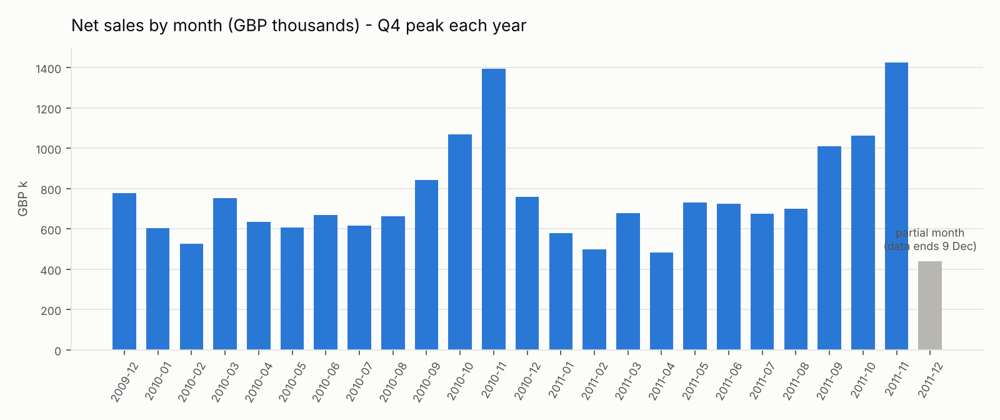
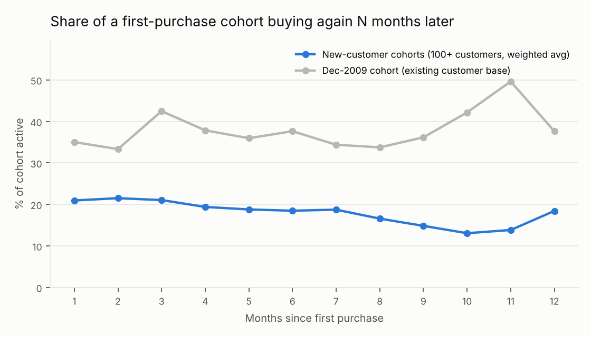

# Sales Ops Monthly Reporting

**A repeatable month-end sales pack built from 1.07M raw retail transactions:**
Python ETL → SQLite warehouse → SQL KPI layer → formula-driven Excel report with VBA
automation → Access queries → Power BI semantic model with time intelligence and row-level security.

Data: UCI Online Retail II, a UK online gift-ware wholesaler/retailer, Dec 2009 – Dec 2011.



## What the cleaning found

| Issue in the raw file | Lines | Handling |
|---|---:|---|
| 1,088 invoices appear in **both** Excel sheets | 22,523 | verified identical, kept once |
| Exact duplicate lines | 11,812 | removed |
| No Customer ID | 235,151 | **kept**: dropping them would remove £2.58M (13.1%) of sales |
| Postage, fees, manual & bad-debt lines | 5,823 | separated from product revenue |
| Zero-price / negative-qty stock write-offs | 5,961 | separated from product revenue |

Nothing is deleted silently: every line gets a `line_type`, and every step is counted in
[`reports/data_quality_log.csv`](reports/data_quality_log.csv).

## Key findings
- **Net sales £18.93M** (gross £19.64M, cancellations £0.72M); November is the peak month each year.
- **Concentration:** the top 1% of identified customers bring 31% of customer sales; the top 20% bring 77%.
- **Retention:** about 21% of a new customer cohort buys again 3 months later. The first month
  in the data (Dec 2009) is the existing customer base, not new customers; its retention (42%) would
  overstate the figure if mixed in.
- **One order can move a month:** Dec 2011 shows a 28.3% cancellation rate, but 1.3% once a single
  80,995-unit order entered and cancelled the same day is excluded. Dec 2011 is also a partial
  month (data ends 9 Dec), which the report flags automatically.

Full write-up: [`reports/findings.md`](reports/findings.md)



## The monthly report (Excel)
[`excel/sales_ops_monthly_report.xlsx`](excel/sales_ops_monthly_report.xlsx)
- Pick a month from the drop-down in `Report!C3`. Every KPI, prior month, same month last year,
  MoM change, regional split and YTD figure recalculates (`INDEX/MATCH`, `SUMIFS`, `SUMPRODUCT`,
  `MAXIFS` on structured table references).
- Partial-month warning and a tie-out check (regional total = net sales) are formulas, not notes.
- Conditional formatting highlights ±10% month-on-month moves.
- Data sheets are Excel Tables (`tblMonthly`, `tblRegion`, …), ready for pivots.

**VBA** – [`excel/vba/MonthlyReport.bas`](excel/vba/MonthlyReport.bas): `BuildMonthlyPack` rebuilds a
region × month pivot table, freezes a values-only snapshot sheet for the month, and exports the report
to PDF; `BuildAllCompleteMonths` does it for every complete month.

**Access** – [`sql/access/access_queries.sql`](sql/access/access_queries.sql): the core KPIs in Access SQL
(IIf, Format, saved-query joins, a parameter query, a make-table snapshot).

## Power BI
[`powerbi/`](powerbi/) holds the Power Query scripts, 27 DAX measures and a build guide:
like-for-like YoY that handles the partial last month, MTD/YTD/rolling 3-month, new vs returning
customers, product ranking, and **row-level security** by region (UK / EU / Rest of World), plus
workspace, app and refresh set-up in Power BI Service.

## Project layout
```
data/README.md            how to download the source file (not committed, 43.5 MB)
src/etl.py                load both sheets, de-duplicate, classify lines, star schema -> SQLite
sql/sales_ops_queries.sql KPI layer (CTEs, window functions: LAG, RANK, running totals, cohorts)
src/report.py             runs the SQL, builds charts, Excel report and findings
excel/                    monthly report workbook + VBA module
sql/access/               Access SQL versions
powerbi/                  M queries, DAX measures, build guide
reports/                  findings, KPI tables, charts, data-quality log
tests/                    tie-out and integrity tests (pytest)
```

## Run it
```bash
pip install -r requirements.txt
# put online_retail_II.xlsx in data/raw/  (see data/README.md)
python run_all.py        # ~1–2 minutes the first time (Excel parsing), then cached
python -m pytest -q
```

## Data source
Chen, D. (2012). *Online Retail II* [Dataset]. UCI Machine Learning Repository.
https://doi.org/10.24432/C5CG6D — CC BY 4.0.
